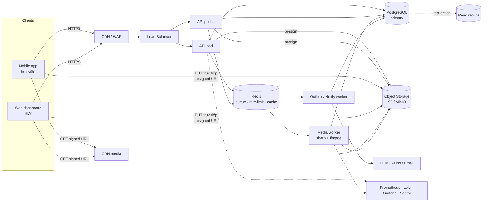
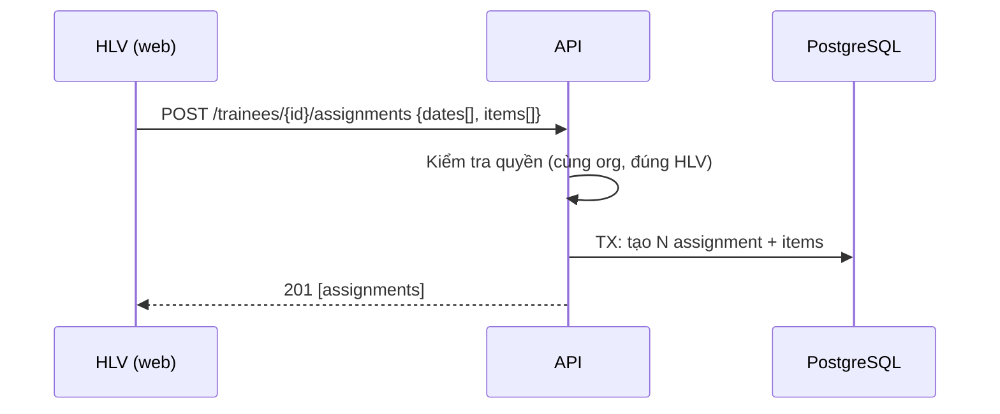
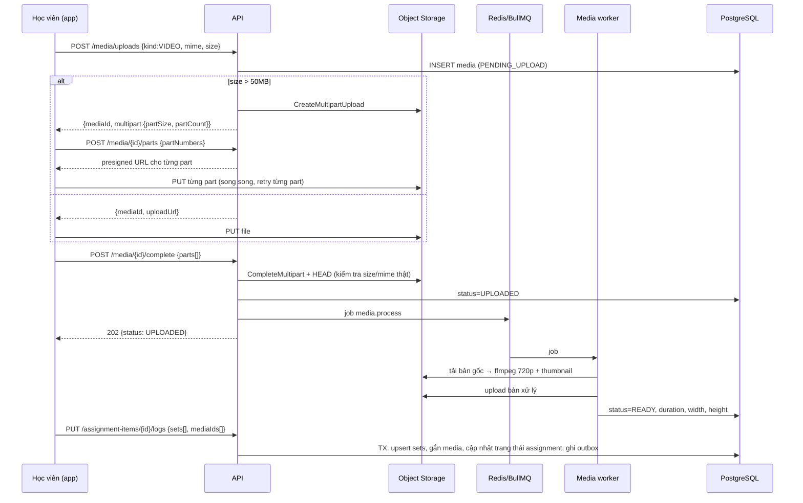
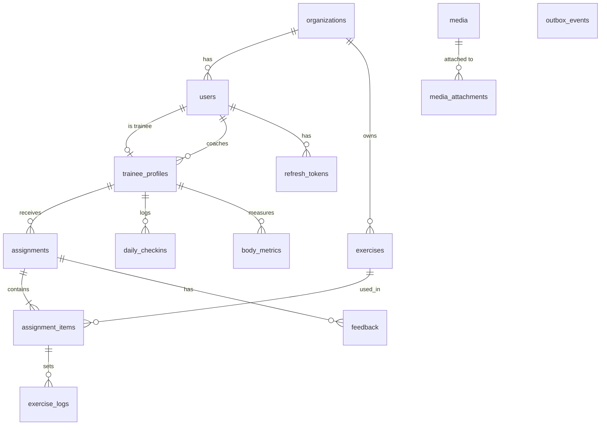

# CoachTrack — Kiến trúc hệ thống

Nền tảng cho huấn luyện viên (HLV) giao bài tập hằng ngày cho học viên, học viên ghi kết quả + upload ảnh/video, HLV phản hồi và theo dõi tiến bộ theo thời gian.

---

## 1. Yêu cầu & giả định thiết kế

| Hạng mục | Mục tiêu |
|---|---|
| Quy mô ban đầu | 1.000 HLV, 50.000 học viên, ~100k bản ghi/ngày, ~30k media/ngày |
| Quy mô mục tiêu | x10 không phải viết lại (scale ngang API/worker, tách đọc/ghi DB) |
| Media | Ảnh ≤ 20 MB, video ≤ 2 GB (quay điện thoại), xem lại mượt trên 4G |
| Độ trễ API | p95 < 200 ms cho đọc, < 400 ms cho ghi (không tính upload) |
| Sẵn sàng | 99,9 %, deploy không downtime |
| Bảo mật | Đa tổ chức (multi-tenant), HLV chỉ thấy học viên của mình, media riêng tư |

**Nguyên tắc chủ đạo**

1. **API không bao giờ chạm vào byte của file** — client upload thẳng lên Object Storage bằng presigned URL (multipart cho video). API chỉ cấp quyền và ghi metadata ⇒ API nhẹ, scale rẻ.
2. **Việc nặng chạy bất đồng bộ** — tạo thumbnail, transcode video, gửi thông báo đều qua hàng đợi (BullMQ/Redis), worker scale độc lập.
3. **Stateless API** — JWT access token ngắn hạn, mọi state ở PostgreSQL/Redis/S3 ⇒ thêm pod là scale.
4. **Modular monolith** — một codebase, chia module theo domain, ranh giới rõ ràng. Khi một module cần scale riêng (vd. media) thì tách thành service mà không phải đập lại.
5. **Transactional Outbox** — sự kiện nghiệp vụ (hoàn thành bài, có phản hồi) ghi cùng transaction với dữ liệu, worker phát đi sau ⇒ không mất/không phát sai sự kiện.

---

## 2. Kiến trúc tổng thể



### Thành phần

| Thành phần | Công nghệ | Vai trò | Scale |
|---|---|---|---|
| API | Node.js 22, Fastify 4, TypeScript, Zod | REST API v1, auth, phân quyền, presign | HPA theo CPU/RPS |
| DB | PostgreSQL 16 + Prisma | Nguồn sự thật | Primary + read replica; partition `exercise_logs` theo tháng khi > 100M dòng |
| Queue/Cache | Redis 7 + BullMQ | Job media, outbox relay, rate limit | Redis Sentinel/Cluster |
| Object storage | S3 (prod) / MinIO (dev) | Ảnh/video gốc + bản đã xử lý | Vô hạn; lifecycle chuyển IA/Glacier sau 180 ngày |
| Media worker | Node + sharp + ffmpeg | Thumbnail, nén ảnh WebP, transcode video 720p H.264 | Autoscale theo độ dài hàng đợi (KEDA) |
| Notify worker | Node | Relay outbox → push/email | 1–3 replica |
| CDN | CloudFront / Cloudflare | Phân phối media với signed URL | — |

---

## 3. Cấu trúc component (code)

```
coach-platform/
├─ docker-compose.yml          # postgres, redis, minio, api, worker
├─ docs/ARCHITECTURE.md
└─ apps/api/
   ├─ prisma/schema.prisma     # Database schema
   ├─ src/
   │  ├─ config/env.ts         # Đọc & validate biến môi trường (Zod) — fail fast
   │  ├─ lib/                  # Hạ tầng dùng chung, không chứa nghiệp vụ
   │  │  ├─ errors.ts          #   AppError + mã lỗi chuẩn
   │  │  ├─ storage.ts         #   S3: presign PUT/GET, multipart, HEAD
   │  │  ├─ queue.ts           #   BullMQ queues
   │  │  ├─ access.ts          #   Phân quyền theo học viên (tenant + coach)
   │  │  └─ pagination.ts      #   Cursor pagination
   │  ├─ plugins/              # Fastify plugins: prisma, auth, error handler
   │  ├─ modules/              # Mỗi module = routes + service + schema
   │  │  ├─ auth/              #   login, refresh rotation, logout
   │  │  ├─ trainees/          #   quản lý học viên
   │  │  ├─ exercises/         #   thư viện bài tập
   │  │  ├─ assignments/       #   giao bài theo ngày, ghi set, feedback
   │  │  ├─ checkins/          #   check-in hằng ngày + chỉ số cơ thể
   │  │  ├─ media/             #   upload ảnh/video, gallery
   │  │  ├─ progress/          #   thống kê tiến bộ, dashboard HLV
   │  │  └─ health/            #   liveness/readiness
   │  ├─ workers/              # Tiến trình riêng: media + outbox
   │  ├─ app.ts                # Ghép plugin + module (dùng được trong test)
   │  └─ server.ts             # Entry: listen + graceful shutdown
   └─ test/
```

**Quy ước module:** `*.routes.ts` (HTTP + schema Zod) → `*.service.ts` (nghiệp vụ, transaction) → Prisma. Route không gọi Prisma trực tiếp với logic phức tạp; service không biết về HTTP. Mọi truy cập dữ liệu học viên đi qua `access.ts`.

---

## 4. Luồng dữ liệu

### 4.1 Giao bài hằng ngày


Giao cho nhiều ngày một lần (`dates[]`) để HLV lên giáo án cả tuần.

### 4.2 Học viên tập & upload video (luồng quan trọng nhất)



**Đảm bảo:**
- Upload hỏng giữa chừng → chỉ cần upload lại part lỗi (multipart). Media `PENDING_UPLOAD` quá 24h bị dọn (job định kỳ + S3 lifecycle `AbortIncompleteMultipartUpload`).
- Job xử lý idempotent (key = mediaId), retry 5 lần backoff mũ; thất bại cuối → `FAILED` nhưng **bản gốc vẫn xem được**.
- Client không chờ xử lý: ghi log bài tập ngay với `mediaId`, UI hiển thị "đang xử lý".

### 4.3 HLV xem & phản hồi

`GET /coach/dashboard?date=` → danh sách học viên + trạng thái hôm nay (hoàn thành / chưa làm / chờ phản hồi) → mở assignment → `GET /media/{id}` nhận signed URL (TTL 15 phút) → `POST /assignments/{id}/feedback` → outbox → push cho học viên.

### 4.4 Theo dõi tiến bộ

`GET /trainees/{id}/progress?from&to` tổng hợp: tỷ lệ tuân thủ, chuỗi ngày (streak), xu hướng chỉ số cơ thể, check-in (năng lượng/giấc ngủ), và `GET /trainees/{id}/progress/exercises/{exerciseId}` cho đồ thị tạ max / volume / thời lượng theo ngày. Truy vấn tổng hợp dùng index `(trainee_id, date)` và có thể chuyển sang read replica (`DATABASE_REPLICA_URL`).

---

## 5. Thiết kế API (REST, `/api/v1`)

Chuẩn chung: JSON, `Authorization: Bearer <access>`, lỗi dạng `{ "error": { "code", "message", "details?" } }`, phân trang cursor `?limit=&cursor=` → `{ items, nextCursor }`, ngày dạng `YYYY-MM-DD` theo múi giờ học viên, OpenAPI tại `/docs`.

| Method | Path | Quyền | Mô tả |
|---|---|---|---|
| POST | `/auth/login` | public | Đăng nhập → access (15') + refresh (30 ngày) |
| POST | `/auth/refresh` | public | Xoay vòng refresh token (phát hiện reuse → thu hồi cả họ token) |
| POST | `/auth/logout` | auth | Thu hồi refresh token |
| GET | `/me` | auth | Thông tin người dùng |
| POST | `/trainees` | coach | Tạo học viên (mật khẩu tạm) |
| GET | `/trainees` | coach | Danh sách học viên của HLV |
| GET/PATCH | `/trainees/{id}` | coach, chính học viên (GET) | Chi tiết / cập nhật |
| GET/POST | `/exercises` | coach (POST), mọi người trong org (GET) | Thư viện bài tập |
| PATCH | `/exercises/{id}` | coach | Cập nhật / lưu trữ |
| POST | `/trainees/{id}/assignments` | coach | Giao bài cho 1..60 ngày |
| GET | `/trainees/{id}/assignments?from&to` | coach, học viên | Lịch bài tập |
| GET | `/assignments/{id}` | coach, học viên | Chi tiết + items + logs + media + feedback |
| PATCH | `/assignments/{id}` | coach (nội dung), học viên (status) | Có `version` — optimistic locking |
| DELETE | `/assignments/{id}` | coach | Xoá bài chưa làm |
| PUT | `/assignment-items/{id}/logs` | học viên | Ghi các set (idempotent, ghi đè) + gắn media |
| POST/GET | `/assignments/{id}/feedback` | coach (POST) | Phản hồi, chấm điểm |
| PUT | `/trainees/{id}/checkins/{date}` | học viên | Check-in ngày: tâm trạng, năng lượng, ngủ, đau mỏi, ảnh |
| POST/GET | `/trainees/{id}/metrics` | coach, học viên | Chỉ số cơ thể (cân nặng, vòng eo, ...) |
| POST | `/media/uploads` | auth | Khởi tạo upload (đơn / multipart) |
| POST | `/media/{id}/parts` | uploader | Presign các part |
| POST | `/media/{id}/complete` | uploader | Hoàn tất → xử lý nền |
| GET | `/media/{id}` | có quyền với học viên | Metadata + signed URL |
| DELETE | `/media/{id}` | uploader, coach | Xoá mềm |
| GET | `/trainees/{id}/media?kind&from&to` | coach, học viên | Thư viện ảnh/video theo thời gian (so sánh trước/sau) |
| GET | `/trainees/{id}/progress?from&to` | coach, học viên | Tổng hợp tiến bộ |
| GET | `/trainees/{id}/progress/exercises/{exerciseId}` | coach, học viên | Chuỗi số liệu 1 bài tập |
| GET | `/coach/dashboard?date` | coach | Tổng quan trong ngày |
| GET | `/healthz`, `/readyz` | public | Probe K8s |

---

## 6. Database schema



Điểm thiết kế chính (chi tiết trong `apps/api/prisma/schema.prisma`):

- **UUID v4** cho mọi khoá chính (an toàn khi lộ ra URL, merge/shard dễ). `outbox_events` dùng BIGSERIAL để giữ thứ tự.
- **`org_id` có mặt ở mọi bảng gốc** → lọc tenant ở tầng truy vấn; sẵn sàng bật Row Level Security nếu cần.
- **`assignments(trainee_id, date)`** index chính cho lịch & thống kê; `date` kiểu `DATE` (không có giờ) tránh lệch múi giờ.
- **`exercise_logs`** là bảng lớn nhất: unique `(assignment_item_id, set_index)` giúp upsert idempotent; index `(trainee_id, logged_at)`; partition theo tháng khi lớn.
- **`body_metrics`** dạng key–value (`metric_key`, `value`, `unit`) → thêm chỉ số mới không cần migration.
- **`media` + `media_attachments`** (đa hình: ASSIGNMENT / EXERCISE_LOG / CHECKIN / FEEDBACK) → một file có thể gắn nhiều nơi, gallery truy vấn theo `(trainee_id, created_at)`.
- **`version`** trên `assignments` cho optimistic locking (HLV và học viên cùng sửa).
- **`refresh_tokens`** lưu hash SHA-256 + `family_id` để phát hiện token bị đánh cắp.

---

## 7. Khả năng mở rộng

| Nút thắt | Giải pháp |
|---|---|
| Băng thông upload | Upload thẳng S3, multipart song song; API không proxy byte |
| CPU transcode | Worker tách riêng, autoscale theo độ dài queue; có thể thay bằng AWS MediaConvert khi > 10k video/ngày |
| Đọc thống kê nặng | Read replica; cache Redis 60s cho dashboard; bảng tổng hợp ngày (materialized) khi cần |
| Bảng log lớn | Partition theo tháng, BRIN index trên `logged_at` |
| Kết nối DB | PgBouncer (transaction mode) trước Postgres; `connection_limit` nhỏ mỗi pod |
| Chi phí lưu trữ media | Lifecycle: bản gốc video → IA sau 30 ngày, Glacier sau 180 ngày; giữ bản 720p cho xem lại |

## 8. Bảo mật

- Argon2id cho mật khẩu; JWT HS256/RS256 access 15'; refresh rotation + reuse detection.
- Phân quyền theo vai trò + quan hệ HLV–học viên + tenant (`lib/access.ts`) — kiểm tra ở mọi endpoint có `traineeId`.
- Bucket media **private**; chỉ truy cập qua signed URL TTL ngắn; kiểm tra lại `Content-Length`/`Content-Type` thực tế sau upload; whitelist MIME.
- Rate limit theo IP + user (Redis), helmet, CORS whitelist, giới hạn body 1 MB.
- Log không chứa token/mật khẩu (pino redact). Xoá học viên → job xoá media (GDPR / NĐ 13/2023 về dữ liệu cá nhân).

## 9. Vận hành

- **Observability:** log JSON (pino) có `reqId`; metrics Prometheus (`/metrics` nội bộ); tracing OpenTelemetry; Sentry cho lỗi.
- **Health:** `/healthz` (process sống), `/readyz` (DB + Redis OK) — dùng cho K8s probe.
- **Deploy:** Docker multi-stage, non-root; `prisma migrate deploy` chạy như Job trước rollout; rolling update; graceful shutdown (đóng server → chờ request → đóng DB/queue).
- **CI:** lint → typecheck → test → build image → migrate staging → e2e → promote.
- **Backup:** PITR Postgres (WAL), versioning S3, kiểm tra khôi phục hằng quý.
- **SLO & cảnh báo:** p95 latency, tỷ lệ 5xx, độ dài queue media, tỷ lệ job FAILED, tuổi outbox chưa xử lý.

## 10. Lộ trình mở rộng tính năng

1. Template giáo án (program) nhiều tuần, áp dụng cho nhóm học viên.
2. Chat HLV–học viên (WebSocket qua Redis pub/sub).
3. AI phân tích tư thế từ video (worker riêng, GPU) — gắn vào pipeline media sẵn có.
4. Thanh toán gói tập.
